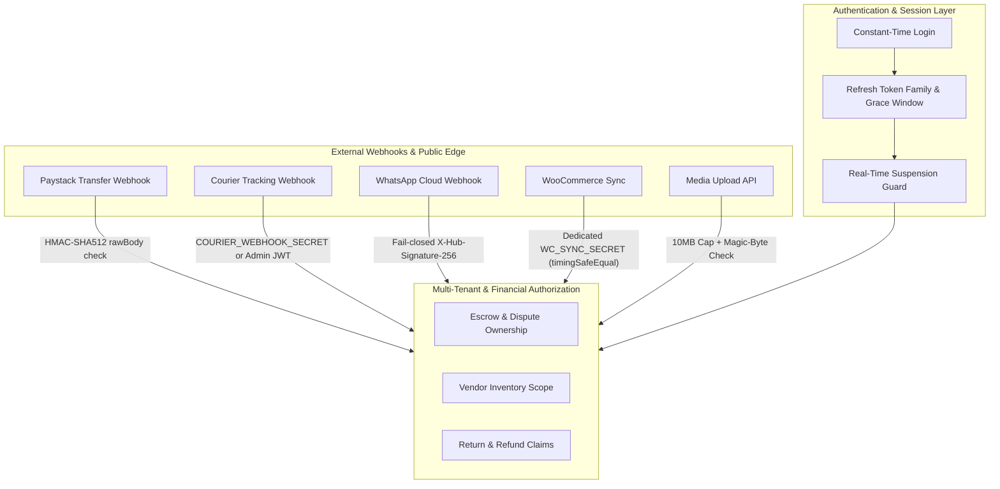
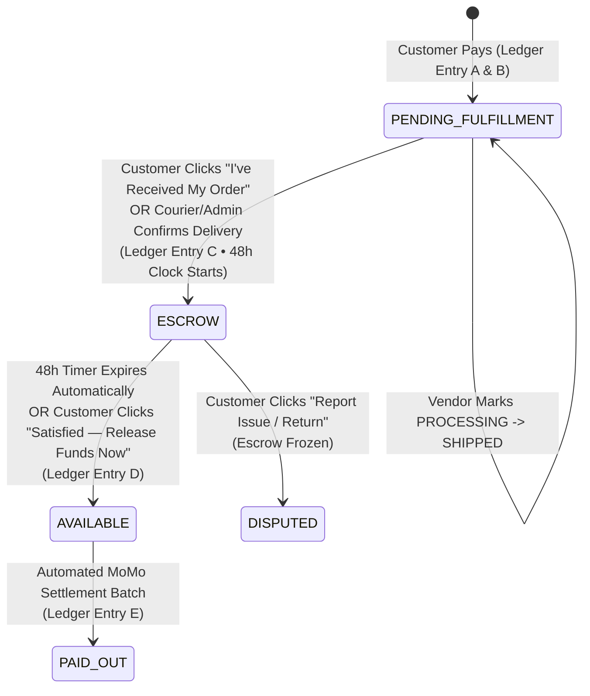

# NextDor Architecture, Security Hardening & 48-Hour Escrow Specification

This document records every production fix, security patch, and architectural decision made across `next-backend` and `next-frontend`, along with the **engineering and security rationale ("the why")** behind each choice.

---

## Table of Contents
1. [Part 1: Production Stability, Database & Payment Configuration](#part-1-production-stability-database--payment-configuration)
2. [Part 2: Principal Security Audit & Hardening (10 Loopholes Fixed)](#part-2-principal-security-audit--hardening-10-loopholes-fixed)
3. [Part 3: 48-Hour Escrow & Delivery Verification Architecture](#part-3-48-hour-escrow--delivery-verification-architecture)

---

## Part 1: Production Stability, Database & Payment Configuration

### 1.1 Fail-Open Redis Circuit Breaker (Graceful Degradation)
- **Files:** [`next-backend/src/lib/redis.ts`](next-backend/src/lib/redis.ts), [`next-backend/src/lib/email.queue.ts`](next-backend/src/lib/email.queue.ts), [`next-backend/src/server.ts`](next-backend/src/server.ts)
- **The Problem:** When Upstash or local Redis was unreachable (`ECONNREFUSED`), BullMQ email queues, rate limiters, and cache reads threw unhandled connection errors or stalled requests.
- **The Choice:** Implemented a non-blocking Redis client with a fast 5-attempt circuit breaker (`isRedisAvailable()`), in-memory rate-limit fallback in Fastify, null-safe cache wrappers (`getCache`/`setCache`), and direct Resend email fallback when BullMQ cannot reach Redis.
- **Why This Choice Was Made:**
  - Redis in NextDor serves as a **performance & background-queue accelerator**, not the primary source of financial truth (PostgreSQL is the source of truth).
  - Crashing checkout or customer logins because a cache/queue node is temporarily unreachable violates high-availability principles. Failing open to PostgreSQL and direct email dispatch keeps revenue-critical paths online with zero data loss.

### 1.2 Neon PostgreSQL Idle Connection Recovery & Retry Middleware
- **Files:** [`next-backend/src/lib/prisma.ts`](next-backend/src/lib/prisma.ts)
- **The Problem:** Serverless Neon PostgreSQL closes idle TCP connections after ~5 minutes (`Error { kind: Closed }`), causing the first incoming request after an idle period to fail with a 500 error.
- **The Choice:** Added connection pool keepalive parameters (`connect_timeout=15&pool_timeout=15&socket_timeout=30`) and a transparent 1-retry `$use` middleware for transient connection-closed errors (`P1001`, `P1002`, `P1008`, `P1017`, `kind: Closed`).
- **Why This Choice Was Made:**
  - Running a constant heartbeat query wastes serverless compute hours and prevents Neon from scaling to zero when idle.
  - Catching transient socket closure and immediately retrying once inside Prisma middleware masks cold-connection drops from end users without keeping Neon awake 24/7.

### 1.3 Backward-Compatible `OrderStatus` Enum & `vendor_orders` Schema Reconciliation
- **Files:** [`next-backend/prisma/schema.prisma`](next-backend/prisma/schema.prisma), [`next-backend/src/scripts/fix-vendor-orders-schema.ts`](next-backend/src/scripts/fix-vendor-orders-schema.ts)
- **The Problem:** Customer `/account` orders failed with a 500 error because existing database rows contained legacy `OrderStatus` values (`PENDING`, `CONFIRMED`, `PROCESSING`, `SHIPPED`, `DELIVERED`, `REFUNDED`) that had been removed from Prisma's schema, and `vendor_orders` was missing the 6 escrow columns (`deliveryFeeAlloc`, `fundsStatus`, `deliveryVerifiedAt`, `escrowStartedAt`, `escrowExpiresAt`, `flaggedForReview`).
- **The Choice:** Restored the legacy enum values alongside the new lifecycle states (`PLACED`, `ACCEPTED`, `DISPATCHED`, `DELIVERED_VERIFIED`, `COMPLETED`, `CANCELLED`, `DISPUTED`) in `schema.prisma` and added the missing escrow columns and `VendorFundsStatus` enum to PostgreSQL idempotently (`ADD COLUMN IF NOT EXISTS`).
- **Why This Choice Was Made:**
  - Destructively migrating or deleting historical production orders would break audit trails and customer order histories.
  - Supporting both the legacy enum values and the new escrow lifecycle states guarantees 100% backward compatibility for existing orders while enabling the new ledger-backed workflow.

### 1.4 Paystack Live Key Prioritization (`PAYSTACK_LIVE_KEY`)
- **Files:** [`next-backend/src/config/env.ts`](next-backend/src/config/env.ts)
- **The Problem:** The environment configuration only read `PAYSTACK_SECRET_KEY`, ignoring `PAYSTACK_LIVE_KEY` when both existed in `.env`.
- **The Choice:** Updated `env.ts` to validate `PAYSTACK_LIVE_KEY` and automatically promote it to `env.PAYSTACK_SECRET_KEY` whenever it begins with `sk_live_`.
- **Why This Choice Was Made:**
  - Every payment service, transfer service, and webhook HMAC verifier in the codebase reads `env.PAYSTACK_SECRET_KEY`. Promoting `PAYSTACK_LIVE_KEY` at the config boundary switches the entire payment and MoMo settlement pipeline to live mode in one place without risking a mismatch between checkout charging and webhook verification.

---

## Part 2: Principal Security Audit & Hardening (10 Loopholes Fixed)

### 2.1 Critical — Paystack Transfer Webhook HMAC Signature Verification
- **File:** [`next-backend/src/modules/payouts/payout.routes.ts`](next-backend/src/modules/payouts/payout.routes.ts)
- **Vulnerability:** `POST /api/v1/webhooks/paystack-transfer` processed `transfer.success` and `transfer.failed` events without verifying the `x-paystack-signature` header. An attacker could spoof transfer webhooks to corrupt the double-entry ledger and mark vendor payouts as settled or reversed.
- **The Choice:** Enforced `paystackTransfer.verifyWebhookSignature(rawBody, signature)` using HMAC-SHA512 against `req.rawBody` before parsing any event payload.
- **Why This Choice Was Made:**
  - Webhook endpoints are publicly reachable by design; IP allowlisting alone is fragile and cloud IPs can change.
  - Verifying the cryptographic HMAC-SHA512 signature over the exact raw request bytes (`rawBody`, not re-serialized JSON) is the only mathematically sound proof that the payload originated from Paystack and was not tampered with in transit.

### 2.2 High — Escrow & Dispute Broken Object-Level Authorization (IDOR)
- **Files:** [`next-backend/src/modules/orders/escrow.service.ts`](next-backend/src/modules/orders/escrow.service.ts), [`next-backend/src/modules/orders/escrow.routes.ts`](next-backend/src/modules/orders/escrow.routes.ts)
- **Vulnerability:** Any authenticated user who knew a `vendorOrderId` could call `/orders/escrow/verify-delivery`, `/confirm-receipt`, or `/dispute` on another customer's order. Even worse, a vendor could call `/verify-delivery` with `confirmedBy: "DELIVERY_AGENT"` to start their own 48-hour escrow clock.
- **The Choice:**
  1. Restricted `DELIVERY_AGENT` and `TRACKING_SYSTEM` confirmations on `/verify-delivery` exclusively to `ADMIN` users (`isAdmin`).
  2. Verified `actorId === vo.order.userId` inside `EscrowService.verifyDelivery`, `confirmCustomerReceipt`, and `openDispute`.
- **Why This Choice Was Made:**
  - Financial state transitions (`PENDING_FULFILLMENT` → `ESCROW` → `AVAILABLE` / `DISPUTED`) directly control when money leaves the platform.
  - Enforcing ownership inside the domain service (`EscrowService`) rather than only at the route layer ensures that no future controller or internal caller can accidentally bypass customer ownership checks (defense-in-depth).

### 2.3 High — Multi-Vendor Inventory IDOR (Cross-Tenant Stock Manipulation)
- **Files:** [`next-backend/src/modules/inventory/inventory.routes.ts`](next-backend/src/modules/inventory/inventory.routes.ts), [`next-backend/src/modules/inventory/inventory.service.ts`](next-backend/src/modules/inventory/inventory.service.ts)
- **Vulnerability:** Inventory routes used `requireVendor` (which checks role `VENDOR` or `ADMIN`) without scoping queries or mutations to the authenticated vendor's `vendorId`. One merchant could zero out a competitor's stock or create warehouses under another vendor's ID.
- **The Choice:** Added `resolveInventoryScope(req, reply)` in the route layer and `assertStockAccess(productId, warehouseId, vendorId)` inside `InventoryService` so vendors can only view or modify products and warehouses belonging to their own store.
- **Why This Choice Was Made:**
  - In a multi-tenant marketplace, role-based access control (`role === "VENDOR"`) is insufficient without tenant isolation (`product.vendorId === authVendorId`).
  - Checking ownership on both the product and the warehouse prevents cross-tenant relational linking (e.g., linking Vendor A's product to Vendor B's warehouse).

### 2.4 High — Refresh Token Family False-Positive Revocation & Suspension Enforcement
- **Files:** [`next-backend/src/modules/auth/auth.service.ts`](next-backend/src/modules/auth/auth.service.ts), [`next-backend/src/modules/auth/auth.routes.ts`](next-backend/src/modules/auth/auth.routes.ts)
- **Vulnerability:**
  1. `_executeRefresh` checked if *any* token in the token family was rotated (`revokedAt !== null`) and older than 30 seconds, rather than checking if the *submitted* token was already revoked. Because the first refresh creates a rotated parent token, the second refresh >30 seconds later always triggered a false-positive "token replay" alarm and logged the user out.
  2. Suspended or soft-deleted users could continue refreshing tokens or calling `/auth/me` until their 7-day refresh token expired.
- **The Choice:**
  1. Changed `_executeRefresh` to check `if (matchedToken.revokedAt)` on the **submitted token**, allowing a 30-second grace window for concurrent browser tab refreshes while revoking the family only when a genuinely revoked token is re-used after 30 seconds.
  2. Added `user.deletedAt || user.status === "SUSPENDED"` rejection in `_executeRefresh` and `/auth/me`, and revoked all refresh tokens immediately when an admin is suspended.
- **Why This Choice Was Made:**
  - RFC 6819 / OAuth 2.0 refresh token rotation requires detecting reuse of an *already-rotated token*, not penalizing the existence of historical rotated tokens in the same family.
  - Simultaneously, adding a 30-second grace window solves the real-world browser race condition where multiple tabs refresh at the same millisecond, without weakening replay detection.

### 2.5 Medium — Return & Refund Claims IDOR
- **File:** [`next-backend/src/modules/returns/return.service.ts`](next-backend/src/modules/returns/return.service.ts)
- **Vulnerability:** `requestReturn` allowed non-owners if `role !== "CUSTOMER"` (meaning any `VENDOR` could file a return on any customer's order), `disputeReturn` didn't verify `returnReq.userId === userId`, and `getReturnDetail` allowed any vendor to inspect any other vendor's return claims.
- **The Choice:** Enforced strict customer ownership (`order.userId === userId`) on `requestReturn` and `disputeReturn` (with admin override only for `ADMIN`), and verified vendor ownership (`item.product.vendorId === vendor.id`) in `getReturnDetail`.
- **Why This Choice Was Made:**
  - Return claims freeze vendor escrow and can trigger refunds. Only the buyer who paid for the order (or a platform administrator) should be able to initiate or escalate a return claim.

### 2.6 Medium — Unauthenticated Courier Webhook & Shipment Listing IDOR
- **Files:** [`next-backend/src/modules/logistics/logistics.routes.ts`](next-backend/src/modules/logistics/logistics.routes.ts), [`next-backend/src/config/env.ts`](next-backend/src/config/env.ts)
- **Vulnerability:** `POST /api/v1/logistics/webhook` had no authentication at all, and `GET /api/v1/logistics/orders/:orderId/shipments` returned full courier phone numbers and recipient details to any logged-in user who passed an `orderId`.
- **The Choice:** Added `requireCourierAuth` (verifying `x-courier-signature` HMAC-SHA256 / `x-courier-secret` against `COURIER_WEBHOOK_SECRET` with `crypto.timingSafeEqual`, or an Admin JWT) and verified customer/vendor/admin ownership on `/orders/:orderId/shipments`.
- **Why This Choice Was Made:**
  - Because courier `DELIVERED` webhooks now automatically trigger the 48-hour escrow clock (`EscrowService.verifyDelivery`), leaving `/logistics/webhook` unauthenticated would allow anyone to prematurely unlock vendor escrow funds.

### 2.7 Medium — WhatsApp Webhook Fail-Closed Signature Verification
- **File:** [`next-backend/src/modules/notifications/whatsapp.routes.ts`](next-backend/src/modules/notifications/whatsapp.routes.ts)
- **Vulnerability:** If `WHATSAPP_APP_SECRET` was unset or left as a placeholder, the webhook logged a warning and accepted unsigned payloads even in production.
- **The Choice:** Configured the webhook to fail closed (`401 Unauthorized`) in production whenever `WHATSAPP_APP_SECRET` is missing/placeholder or `X-Hub-Signature-256` fails `crypto.timingSafeEqual`.
- **Why This Choice Was Made:**
  - Security controls must **fail closed** in production so a missing environment variable cannot silently disable webhook authentication.

### 2.8 Medium — Key Separation for WooCommerce Sync (`WC_SYNC_SECRET`)
- **File:** [`next-backend/src/modules/sync/sync.routes.ts`](next-backend/src/modules/sync/sync.routes.ts)
- **Vulnerability:** The WooCommerce sync endpoint accepted `env.JWT_SECRET` as a fallback for `x-sync-secret` and compared strings with `!==`.
- **The Choice:** Removed `JWT_SECRET` fallback (requiring a dedicated `WC_SYNC_SECRET`) and replaced `!==` with constant-time `crypto.timingSafeEqual`.
- **Why This Choice Was Made:**
  - **Cryptographic key separation** is a foundational security principle: reusing `JWT_SECRET` as an external API header secret means any leak in a third-party WooCommerce plugin would allow an attacker to forge `ADMIN` JWTs for the entire platform.

### 2.9 Medium — Constant-Time Login Enumeration Protection
- **File:** [`next-backend/src/modules/auth/auth.service.ts`](next-backend/src/modules/auth/auth.service.ts)
- **Vulnerability:** When a login email did not exist, `bcrypt.compare(password, "$2b$12$invalidhashpadding")` was called. Because `"$2b$12$invalidhashpadding"` is not a valid 60-character bcrypt hash, `bcryptjs` returned `false` in `<0.1ms` instead of running 2^12 key-derivation rounds (~250ms), allowing attackers to enumerate valid accounts by measuring response time.
- **The Choice:** Replaced the malformed string with a valid 60-character cost-12 bcrypt hash (`DUMMY_BCRYPT_HASH`).
- **Why This Choice Was Made:**
  - A valid cost-12 dummy hash forces `bcryptjs` to perform the full key-stretching computation even when the email is not found, making existing and non-existing accounts indistinguishable by timing.

### 2.10 Low — Media Upload Size Cap & Error Sanitization
- **File:** [`next-frontend/app/api/upload/route.ts`](next-frontend/app/api/upload/route.ts)
- **Vulnerability:** Base64 uploads had no size cap before `Buffer.from(base64Data, "base64")` allocation (risking Node.js OOM crashes), and 500 responses leaked raw filesystem `error.message` strings.
- **The Choice:** Enforced a 14MB base64 length limit (~10MB decoded binary) prior to buffer allocation and returned generic error messages on 500s.
- **Why This Choice Was Made:**
  - Checking string length before allocating memory prevents memory-exhaustion Denial of Service (DoS) with zero CPU overhead.

---

## Part 3: 48-Hour Escrow & Delivery Verification Architecture

### 3.1 Prohibiting Vendors from Marking Orders `DELIVERED`
- **Files:** [`next-backend/src/modules/vendors/vendor.routes.ts`](next-backend/src/modules/vendors/vendor.routes.ts), [`next-backend/src/modules/orders/order.routes.ts`](next-backend/src/modules/orders/order.routes.ts), [`next-backend/src/modules/vendors/vendor.service.ts`](next-backend/src/modules/vendors/vendor.service.ts), [`next-backend/src/modules/vendors/vendor.repository.ts`](next-backend/src/modules/vendors/vendor.repository.ts), [`next-frontend/app/vendor/dashboard/page.tsx`](next-frontend/app/vendor/dashboard/page.tsx)
- **The Problem:** Previously, vendors had a `"Confirm Delivery (Start 48h Escrow)"` button on `SHIPPED` orders. A dishonest or mistaken vendor could click `SHIPPED` and immediately click `DELIVERED` minutes after an order was placed, starting the 48-hour escrow countdown days before the customer actually received the package.
- **The Choice:**
  - Removed `"DELIVERED"` from vendor status update schemas (`PROCESSING`, `SHIPPED`, `CANCELLED` only) and added a hard `ForbiddenError` in `VendorService.updateVendorOrderStatus`.
  - Replaced the button on the Vendor Dashboard with an `"In Transit • Awaiting Customer / Courier Delivery Confirmation"` status indicator.
- **Why This Choice Was Made:**
  - **Conflict of Interest (Separation of Duties):** The vendor is the beneficiary of the escrow payout. Allowing the beneficiary to unilaterally declare that the buyer has received the goods defeats the entire purpose of escrow protection.
  - Only the **receiving party (the customer)** or a **trusted third party (authenticated courier / platform admin)** has no financial incentive to falsify delivery.

### 3.2 Dual-Trigger Delivery Verification (Customer Button + Courier/Admin Fallback)
- **Files:** [`next-frontend/app/account/orders/[number]/page.tsx`](next-frontend/app/account/orders/[number]/page.tsx), [`next-frontend/lib/orders/api.ts`](next-frontend/lib/orders/api.ts), [`next-backend/src/modules/orders/escrow.service.ts`](next-backend/src/modules/orders/escrow.service.ts), [`next-backend/src/modules/logistics/logistics.service.ts`](next-backend/src/modules/logistics/logistics.service.ts), [`next-backend/src/modules/orders/order.service.ts`](next-backend/src/modules/orders/order.service.ts)
- **The Problem:** Customers had no button in the UI to confirm they received their order, and if the system relied *only* on the customer clicking a button, customers who forgot to log back in would trap vendor funds indefinitely.
- **The Choice:** Implemented a **Dual-Trigger Verification Model**:
  1. **Primary Trigger (Customer UI):** On `/account/orders/[number]`, every `SHIPPED` vendor sub-order displays a prominent **"I've Received My Order"** button (`POST /api/v1/orders/escrow/verify-delivery`).
  2. **Secondary Fallback (Courier Webhook & Admin):** When an authenticated courier webhook (`POST /api/v1/logistics/webhook`) or Admin (`PATCH /api/v1/admin/orders/:id/status`) marks a shipment `DELIVERED`, it automatically invokes `EscrowService.verifyDelivery` for any `SHIPPED` sub-orders.
  3. **Safety-Net Fallback (7-Day Dispatch Rule):** `EscrowService.processDispatchFallbacks()` automatically transitions unverified `SHIPPED` orders into the 48-hour escrow window 7 days after dispatch if no dispute was raised.
- **Why This Choice Was Made:**
  - **Protects Buyers:** The 48-hour inspection clock never starts until the package actually arrives (confirmed by the buyer or verified courier delivery), and the buyer receives an immediate email notification when the 48-hour window begins.
  - **Protects Vendors:** Honest merchants are never held hostage by passive buyers who receive their items and forget to click "Received" — courier confirmation (or the 7-day dispatch fallback) ensures the 48-hour clock still starts reliably.

### 3.3 Early Release ("Satisfied — Release Funds Now") vs. 48-Hour Auto-Release
- **Files:** [`next-frontend/app/account/orders/[number]/page.tsx`](next-frontend/app/account/orders/[number]/page.tsx), [`next-backend/src/modules/orders/escrow.service.ts`](next-backend/src/modules/orders/escrow.service.ts)
- **The Problem:** Once an order is delivered and in the 48-hour escrow window (`fundsStatus === "ESCROW"`), a customer who has already inspected their item had no way to release funds early, nor was there a clear contextual prompt showing when the 48-hour protection expires.
- **The Choice:** When a sub-order is in `ESCROW`, the customer sees a **"48-Hour Buyer Protection Window Active"** card displaying the exact expiration date/time along with two explicit choices:
  - **"Satisfied — Release Funds Now"** (`POST /api/v1/orders/escrow/confirm-receipt`): Immediately clears escrow (`ESCROW` → `AVAILABLE`) and writes Ledger Entry D so the merchant can be paid in the next settlement cycle.
  - **"Report Issue / Request Return"**: Opens the return/refund modal and freezes escrow (`ESCROW` → `DISPUTED`) so funds cannot be paid out while the issue is investigated.
- **Why This Choice Was Made:**
  - **Accelerates Merchant Cash Flow:** Small and medium Ghanaian merchants rely on fast working-capital turnover. When a customer is happy on delivery day, letting them release funds with one click rewards great merchant service.
  - **Zero Risk to Passive Buyers:** If the customer takes no action after delivery verification, the 48-hour window remains active and `EscrowScheduler.processExpiredEscrows()` automatically clears the funds after 48 hours.

### 3.4 Unifying Payout & Escrow State Around `fundsStatus` and the Double-Entry Ledger
- **Files:** [`next-backend/src/modules/vendors/vendor.repository.ts`](next-backend/src/modules/vendors/vendor.repository.ts), [`next-backend/src/modules/orders/escrow.service.ts`](next-backend/src/modules/orders/escrow.service.ts)
- **The Problem:** Two incompatible escrow mechanisms previously co-existed in the codebase:
  1. `vendor.repository.ts` set `clearedAt = now + 48h` while leaving `escrowExpiresAt = null` and `fundsStatus = "PENDING_FULFILLMENT"`.
  2. `EscrowScheduler` and `PayoutService` queried `fundsStatus === "ESCROW"` (with `escrowExpiresAt <= now`) and `fundsStatus === "AVAILABLE"`.
  Because of this split, vendor dashboard cards showed different numbers from the actual payout batch engine, and orders marked `DELIVERED` via the old path never transitioned to `AVAILABLE`.
- **The Choice:** Removed the legacy `clearedAt = now + 48h` code path and unified `VendorRepository.findVendorPayouts`, `EscrowService`, `EscrowScheduler`, and `PayoutService` around the single state machine (`fundsStatus`: `PENDING_FULFILLMENT` → `ESCROW` → `AVAILABLE` → `IN_PAYOUT` → `PAID_OUT`) backed by atomic double-entry ledger transactions (Entries A through E).
- **Why This Choice Was Made:**
  - **Single Source of Financial Truth:** Every dashboard metric, customer order badge, and Paystack MoMo payout batch now reads from the exact same `fundsStatus` state machine and double-entry ledger, eliminating reconciliation drift.

